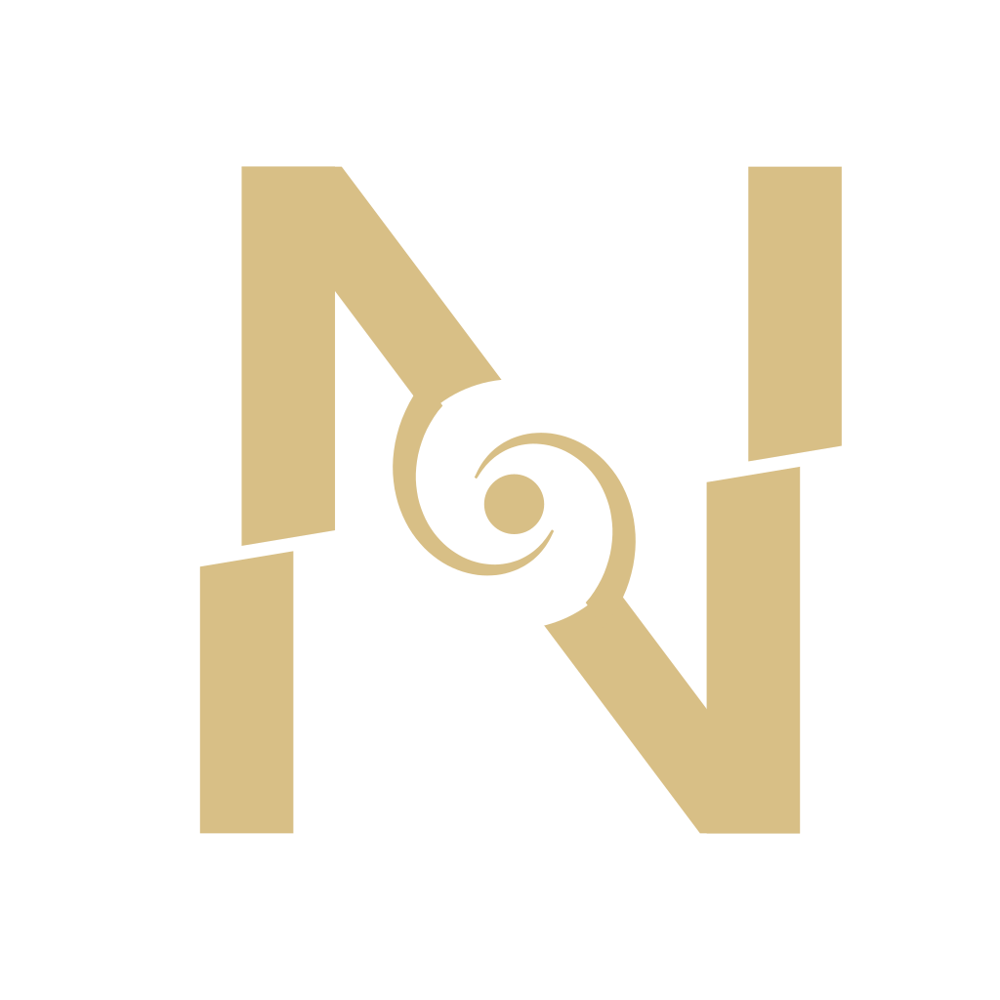

<div align="center">



# Nowaki (野分)

A full-stack web framework built around a Rust toolchain

[](./LICENSE)
[](./ROADMAP.md#where-we-are)

Zero client JS by default. The dev server is a Rust binary that starts instantly. Designed as an answer to the structural slowness of Next.js.

</div>

---

## What is Nowaki?

Nowaki (野分, an archaic Japanese word for a typhoon) is a full-stack framework designed from the ground up around the structural causes of Next.js's slowness. The bundler, transforms, and dev server are written in Rust on top of [oxc](https://oxc.rs), and rendering uses the Islands Architecture. A page's client JS is limited to its "islands".

| Next.js pain point | Nowaki's answer |
|---|---|
| `next dev` starts slowly | A Rust binary starts instantly and transforms on demand (about 90ms to start the example app) |
| HMR is heavy | oxc re-transforms a single file in milliseconds |
| Page JS bloats | With Islands, there is zero client JS outside the islands you mark explicitly |
| Builds are slow | oxc minifier plus a content-hash cache |

> [!WARNING]
> **Status: alpha.** The design is settling, but the API may change without notice. Production use is not yet recommended.

## Features

- An on-demand transform pipeline and bundler in Rust, built on oxc (parser / transformer / codegen / resolver).
- Islands Architecture: zero client JS by default; only components under `islands/` are hydrated, with `client:*` directives for lazy hydration.
- Jetstream islands: server-reactive islands that ship no component JS. State stays on the server, and patches arrive over WebSocket (`nowaki dev` / `nowaki start`) or per event over POST on the deploy adapters. Live queries (`publish`) and shared rooms are included.
- File-based routing with nested layouts, middleware, Remix-style `loader` / `action`, API routes, route groups, and parallel and intercepting routes.
- Server functions (`"use server"`) with Standard Schema validation.
- Content sites: content collections, Markdown / MDX (and Markdoc via `@nowaki-dev/markdoc`), `<Image>` with AVIF and `srcset`, typed `meta`, a generated sitemap, self-hosted fonts, and per-route JS budgets.
- Routing config in `nowaki.config.mjs`: `redirects`, `rewrites`, `headers`, `basePath`, `trailingSlash`, and i18n routing.
- Sessions (`ctx.session`, an encrypted cookie) and a typed env schema (`env.ts`).
- Secure defaults: origin checks, security headers, and an optional CSP nonce.
- Six deploy targets: node, static, bun, deno, cloudflare, vercel. ISR is served from Rust on `nowaki start`, and from the Cache API on the Cloudflare worker.
- On-demand revalidation: `revalidatePath()` / `revalidateTag()` with route-level `tags` purge the `nowaki start` cache, Vercel's CDN, and the Cloudflare cache before the action's response.
- View Transitions in the client router, opt-in per link (`<Link viewTransition>`) or route, with `transitionName()` and a fallback without the API or under reduced motion.
- Observability: `Server-Timing`, JSON logs (`NOWAKI_LOG=json`), OpenTelemetry traces over OTLP that join the Rust front and the renderer, and `/__nowaki/health`.
- Dev experience: HMR that keeps island state (Preact Fast Refresh), CSS without a reload, route and layout edits re-rendered in place, a dev toolbar (route, islands, JS budget, ISR, live connections, errors), and a dev MCP endpoint for coding agents.
- Use the npm ecosystem as is. SSR is delegated to a Rust-managed Node sidecar (Preact).

See <https://nowaki.dev/docs> for the full guide.

## Quick start

You need Node.js 22+ and pnpm (npm and yarn work too). Rust is not required: the CLI fetches a prebuilt native binary from npm.

```bash
# Create a new app
npm create nowaki@latest my-app
cd my-app

pnpm install   # fetches the nowaki CLI (native binary) + runtime
pnpm dev       # → http://127.0.0.1:3000
```

A scaffolded app comes with these npm scripts:

```bash
pnpm dev         # Dev server (HMR + Islands)
pnpm build       # Production build (client + server)
pnpm start       # Serve the built app
pnpm prerender   # Static site generation (SSG)
```

To install the CLI directly, use `npm i -g nowaki`; to install from source, use `cargo install nowaki`.

<details>
<summary>Developing in this repository (for contributors)</summary>

Prerequisites: Rust (stable), Node.js >= 22, pnpm

```bash
git clone https://github.com/Tettu0530/nowaki
cd nowaki
pnpm install
cargo build -p nowaki

# Start the dev server on the example app
./target/debug/nowaki dev examples/hello
# → http://127.0.0.1:3000

# Production build (client: content-hashed ESM + manifest / server: ESM for SSR)
./target/debug/nowaki build examples/hello
# → output in examples/hello/dist/{client,server}/

# Serve the built app in production mode
./target/debug/nowaki start examples/hello --port 3000
# → http://127.0.0.1:3000 (static serving + prod SSR, no HMR)
```

</details>

## What it looks like

```tsx
// routes/index.tsx — the loader runs only on the server
import Counter from "../islands/Counter.tsx";

export const loader = async () => {
  return { message: "Welcome to Nowaki" };
};

export default function Home({ data }) {
  return (
    <main>
      <h1>{data.message}</h1>
      <Counter start={5} />   {/* only this island is hydrated on the client */}
    </main>
  );
}
```

The page body and `loader` code never reach the browser. Only the JS for `islands/Counter.tsx` is shipped.

## Project layout

```
crates/nowaki-core       Bundler core (transform / resolve / cache)
crates/nowaki            CLI + dev server (axum) + HMR + sidecar management
packages/nowaki-runtime  @nowaki-dev/runtime (islands client / SSR sidecar / Node loader hooks)
examples/hello           Example app
```

The nowaki.dev landing page and docs live in [Tettu0530/nowaki-site](https://github.com/Tettu0530/nowaki-site), built with the published packages.

See [DESIGN.md](./DESIGN.md) for design details and architecture diagrams, and [ROADMAP.md](./ROADMAP.md) for what's planned.

## Contributing

Contributions are welcome. Start with [CONTRIBUTING.md](./CONTRIBUTING.md). While Nowaki is in alpha, it's best to discuss your approach in an issue before writing code.

## License

[MIT](./LICENSE) © 2026 [Tettu0530](https://github.com/Tettu0530)

<sub>Created and maintained by [Tettu0530](https://github.com/Tettu0530). "Nowaki" (野分) is an archaic Japanese word for a typhoon.</sub>
