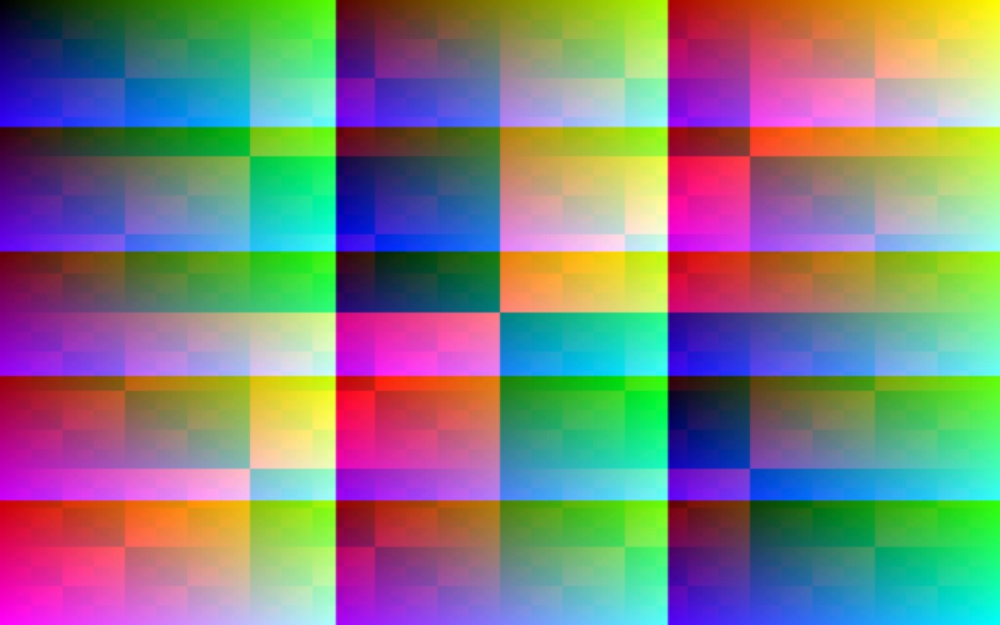

import Counter from "../../islands/Counter.tsx";
export const answer = 6 * 7;

# Components in MDX

MDX is Markdown with JSX: this entry renders an island, an expression ({answer}), and highlighted code.

<Counter start={answer} client:visible />

## Code

```ts
const doubled = [1, 2, 3].map((n) => n * 2);
```

## Image


