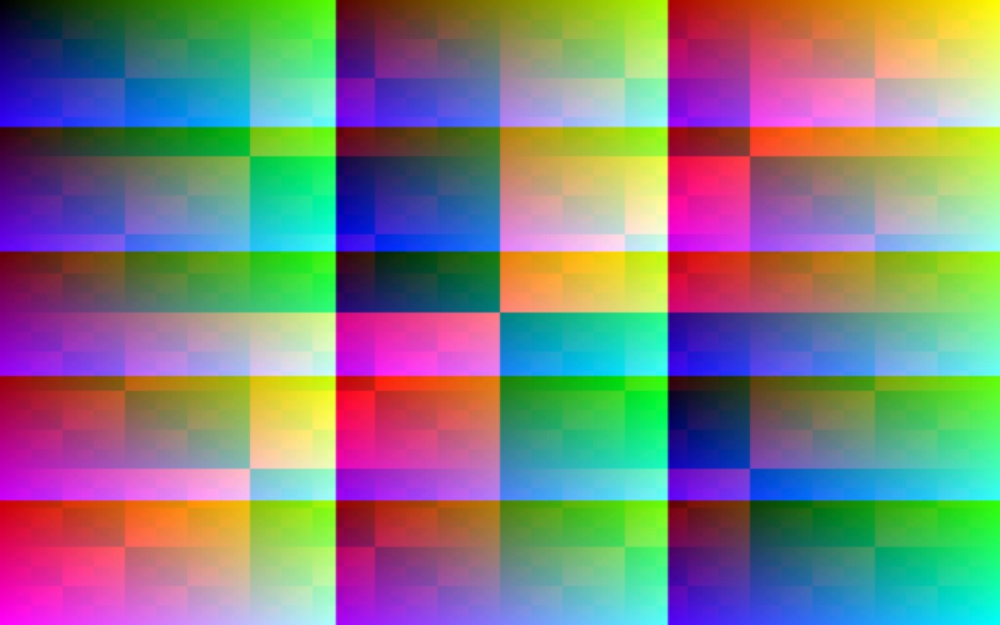

# Introduction

Nowaki renders this page from `content/docs/intro.md` at build time, in Rust.

## Why content collections

- Frontmatter is checked against a schema, so a typo fails the build.
- `getCollection` and `getEntry` are typed from `content/config.ts`.

## Next steps

| Page | What it covers |
|---|---|
| [Routing](/docs/routing) | Files under `routes/` |

## Images

A relative image becomes a responsive `<picture>` at build time:

